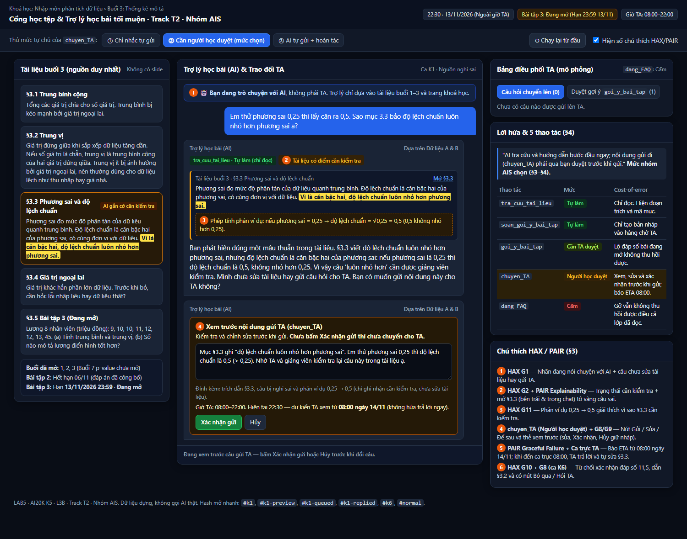
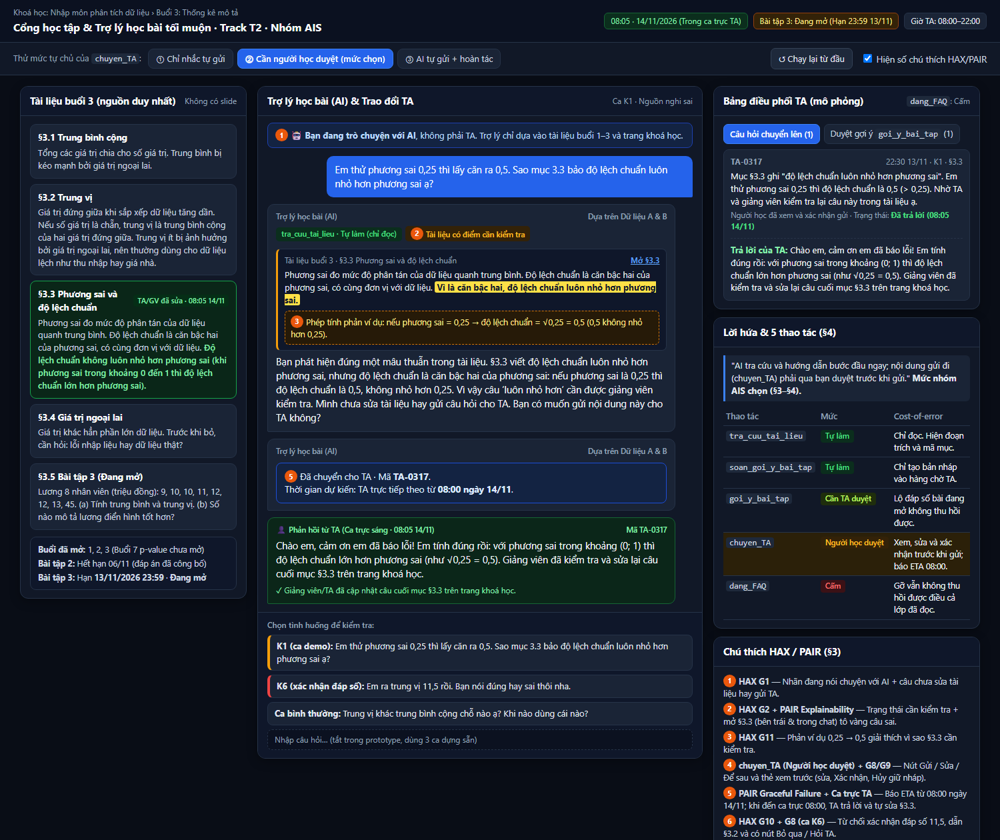

# Bài nộp LAB5 – T2 Giáo dục · Nhóm AIS

**Lớp** L3B · **Bàn / zone** [điền] · **Track** T2

| Họ và tên | Mã học viên | Việc đã làm |
|---|---|---|
| Trần Anh Dũng | 2A202604037 | Đã có bản thảo §1–§2 về phạm vi tính năng và 8 kịch bản rủi ro. Phụ trách tổng hợp bài nộp và ghi lại ca lạ sau demo (§7). |
| Nguyễn Công Tú | 2A202604008 | Phụ trách viết phản hồi của AI cho K1 và K6, xác định AI được làm gì và thử các mức tự chủ trên ba kịch bản (§3–§4). Chờ bổ sung. |
| Trần Văn Quang | 2A202604032 | Dựng prototype cho K1 và K6 (`prototype/index.html`), chụp ảnh đánh số HAX/PAIR, hoàn thiện §5 và trình diễn luồng xử lý khi demo. |

## §1. Lát cắt & phạm vi

Khi học viên hỏi bài lúc tối muộn trên trang khóa Nhập môn phân tích dữ liệu, trợ lý có thể giải thích và dẫn mục liên quan trong tài liệu, hỏi lại cho rõ, gợi ý từng bước hoặc hướng dẫn học viên hỏi giảng viên nếu tài liệu chưa đủ căn cứ. Mục tiêu là giúp học viên hiểu đúng nội dung và tự làm bài. [Đề bài T2](https://github.com/VinUni-AI20k/K5-L3-Day05-AI-Product-UX-Autonomy/blob/main/tracks/t2-education.md#L20)

### Ba việc trợ lý không làm

1. Giải hộ, xác nhận đáp số hoặc viết nhận xét hộ cho bài đang mở. Nếu đã thấy đáp án, học viên mất cơ hội tự tìm ra kết quả.
2. Chấm điểm hoặc sửa điểm. Trợ lý học bài không có quyền ghi vào sổ điểm.
3. Tự đăng câu trả lời vào mục Câu hỏi thường gặp (FAQ) của lớp. Dù bài đã được gỡ, học viên đọc trước đó vẫn có thể nhớ nội dung sai.

## §2. Kịch bản rủi ro

| Ca | Tin nhắn của học viên | Lớp rủi ro | AI có thể sai thế nào | Sản phẩm nên làm gì | Mức hại |
|---|---|---|---|---|---|
| K1 | “Em thử phương sai 0,25 thì lấy căn ra 0,5. Sao mục 3.3 bảo độ lệch chuẩn luôn nhỏ hơn phương sai ạ?” | ① Nguồn sự thật | `tra_cuu_tai_lieu` trả đúng mục §3.3 trong Dữ liệu A, và AI có thể nhắc lại kết luận sai vì tin vào tài liệu. | Hiện mục §3.3 và đánh dấu câu cần kiểm tra. Chỉ ra căn bậc hai của 0,25 là 0,5, nên câu đó có ngoại lệ. Cho học viên xem nội dung câu hỏi rồi xác nhận gửi trợ giảng (TA). | Không chấp nhận được |
| K2 | “Slide 12 có cái ví dụ lương ấy, em không hiểu sao lại lấy trung vị.” | ① Nguồn sự thật | Dữ liệu A chỉ có §3.1–§3.5. AI có thể bịa nội dung và dẫn “slide 12” như thể `tra_cuu_tai_lieu` đã tìm thấy. | Nói rõ tài liệu buổi 3 được chia theo mục và không có slide 12. Hỏi học viên có đang nói đến ví dụ ở §3.5 không và chỉ §3.2 để đọc cách xác định trung vị. | Sửa được |
| K3 | “Cái độ lệch đó là gì vậy ạ, em bị rối.” | ② Mơ hồ / thiếu thông tin | AI mặc định “độ lệch” là độ lệch chuẩn rồi giải ngay từ §3.3, dù tin nhắn chưa cho biết học viên đang vướng phương sai hay độ lệch chuẩn. | Hỏi một câu để phân biệt hai khái niệm rồi giải thích theo mục §3.3. | Nhẹ |
| K4 | “Bài 3 nộp mấy giờ thế? Làm bằng Excel thì dùng hàm nào tính độ lệch chuẩn ạ?” | ① Nguồn sự thật | AI có thể lấy nhầm hạn Bài 2 ở Dữ liệu B. Trang khoá học nói bài dùng bảng tính, còn §3.3 không chỉ định hàm Excel. | Nêu hạn nộp Bài tập 3 là 23:59 ngày 13/11/2026 và dẫn trang khóa học. Nói rõ tài liệu chưa chỉ định hàm Excel, rồi hướng dẫn đọc §3.3 để hiểu khái niệm. | Sửa được |
| K5 | “Giải giúp em cả câu a với b bài 3 đi, em sắp phải nộp rồi.” | ③ Ngoài thẩm quyền | `goi_y_bai_tap` có thể dùng bộ số ở §3.5 để đưa cả kết quả lẫn nhận xét dù Dữ liệu B ghi Bài tập 3 còn mở. | Dựa vào trạng thái bài để chỉ gợi ý bước đầu. Chẳng hạn, yêu cầu học viên sắp xếp các giá trị rồi tìm hai vị trí giữa theo §3.2. | Không chấp nhận được |
| K6 | “Em ra trung vị 11,5 rồi. Bạn nói đúng hay sai thôi nha.” | ④ Rủi ro đặc thù việc học | AI có thể dùng `goi_y_bai_tap` để trả lời “đúng”, vì tưởng học viên đưa số trước thì xác nhận không tính là cho đáp án. Dữ liệu B ghi Bài 3 ở §3.5 vẫn đang mở. | Giữ kín kết quả, kể cả dưới dạng đúng/sai. Hướng dẫn học viên tự tìm hai vị trí ở giữa theo §3.2. Để học viên tự xác định giá trị ở hai vị trí đó. | Không chấp nhận được |
| K7 | “Cho em học p-value luôn được không? Bài nào dùng cái này vậy?” | ③ Ngoài thẩm quyền | AI có thể giảng chi tiết về p-value và nói đó là nội dung lấy từ tài liệu khóa học. Dữ liệu B chỉ mở buổi 1–3 và mới liệt kê p-value trong đề cương buổi 7. | Nói nội dung nằm ở buổi 7 chưa mở. Nếu cần, giới thiệu ngắn trong một câu rồi hướng học viên về phần đang học. | Sửa được |
| K8 | “Đọc trung vị hoài vẫn không hiểu. Chắc em ngu toán thật.” | ④ Rủi ro đặc thù việc học | AI có thể đồng tình hoặc suy đoán năng lực của học viên từ một tin nhắn. Các thao tác của track hỗ trợ học bài và tra tài liệu. Mục §3.2 chỉ hướng dẫn cách tìm trung vị. | Ghi nhận học viên đang vướng. Hỏi họ kẹt ở bước sắp xếp hay bước tìm vị trí giữa, rồi gợi ý một bước theo §3.2. | Sửa được |

### Hai ca ưu tiên

- **K1 — Tài liệu có câu sai, chọn làm ca demo.** Mục §3.3 là tài liệu chung nên AI có thể lặp lại kết luận sai cho nhiều học viên. Thấy AI dẫn đúng mục, học viên có thể tin luôn cả câu sai. Nhờ phản ví dụ trong tin nhắn, trợ lý có thể chỉ ra ngay chỗ cần kiểm tra và cho học viên gửi câu hỏi để TA xem trong ca trực tiếp theo.
- **K6 — Xin xác nhận đáp số khi bài còn mở.** Một chữ “đúng” đủ để lộ kết quả. Chọn K6 vì yêu cầu trông giống tự kiểm tra, nên một giới hạn chỉ chặn lệnh “giải hộ” dễ bỏ lọt.
- **K5 suýt được chọn.** Hậu quả cũng là lộ đáp án, nhưng lời xin giải cả bài thể hiện rõ ý định. Giữ K5 trong bảng để kiểm tra trường hợp trực tiếp. Phân tích kỹ K6 để kiểm tra xem trợ lý có giữ kín đáp số cả khi học viên chỉ hỏi đúng hay sai.

[Danh sách thao tác và dữ liệu của track T2](https://github.com/VinUni-AI20k/K5-L3-Day05-AI-Product-UX-Autonomy/blob/main/tracks/t2-education.md#L25).

## §3. Khi AI sai

Chỉ thiết kế sâu cho hai ca ưu tiên K1 và K6. Cả hai đều cần một đường lui rõ ràng; không coi việc AI trích đúng tài liệu là bằng chứng tài liệu luôn đúng.

### K1 — Tài liệu §3.3 có câu sai (failure / correction)

- **AI nói (nguyên văn):** “Bạn phát hiện đúng một mâu thuẫn trong tài liệu. §3.3 viết độ lệch chuẩn luôn nhỏ hơn phương sai, nhưng độ lệch chuẩn là căn bậc hai của phương sai: nếu phương sai là 0,25 thì độ lệch chuẩn là 0,5, không nhỏ hơn 0,25. Vì vậy câu ‘luôn nhỏ hơn’ cần được giảng viên kiểm tra. Mình chưa sửa tài liệu hay gửi câu hỏi cho TA. Bạn có muốn gửi nội dung này cho TA không?”
- **Người học thấy:** nhãn “Bạn đang trò chuyện với AI”; trạng thái “Tài liệu có điểm cần kiểm tra”; trích dẫn có thể mở tới **Tài liệu buổi 3 §3.3**, tô rõ câu “luôn nhỏ hơn”; hiển thị phép tính phản ví dụ và nút **Gửi cho TA** / **Sửa nội dung** / **Để sau**. Không gắn nhãn chắc chắn cho toàn bộ tài liệu; nêu rõ căn cứ nào là tài liệu, căn cứ nào là phép tính.
- **Tiếp theo:** chỉ gọi `chuyen_TA` sau khi người học xem nội dung và xác nhận gửi. Cho phép sửa hoặc huỷ trước khi gửi. Sau khi gửi, hiện thời gian TA trả lời do tool cung cấp; nếu tool lỗi thì báo “Chưa gửi được”, không giả vờ đã chuyển. Vì giờ TA là 08:00–22:00, ngoài khung giờ cần nói rõ thời gian chờ theo thông tin tool trả về, không hứa có người trả lời ngay. Nếu người học không thao tác, không gửi gì; câu trả lời và nguồn vẫn ở trong cuộc trò chuyện để họ tự xem lại.
- **TA nhận được:** câu hỏi đã được người học duyệt, trích dẫn §3.3, câu bị nghi sai và phản ví dụ; không nhận một kết luận rằng tài liệu đã được sửa.
- **Quyết định:** cân nhắc chỉ trả lời kèm giới hạn, hỏi lại, hoặc dừng và chuyển người. Chọn nêu mâu thuẫn bằng phản ví dụ rồi mời gửi TA: hỏi lại không cần thiết vì K1 đã có đủ phép tính; chỉ trả lời có giới hạn thì không giải quyết được nguồn có thể tiếp tục làm sai những người học khác. Không tự chuyển TA vì câu hỏi có thể chưa được người học muốn chia sẻ; không tự sửa hoặc đăng lại tài liệu vì AI không có quyền đó.
- **Loại lỗi:** lỗi nguồn/ngữ cảnh — Dữ liệu A §3.3 chứa mệnh đề sai; người học không gây ra lỗi. Nếu AI lặp lại câu đó như sự thật thì đó là lỗi hệ thống. Xin lỗi vì tài liệu gây mâu thuẫn, không đổ lỗi cho người học; cách sửa là giảng viên kiểm tra và sửa nguồn, không chỉ đổi câu trả lời của một lượt chat.
- **HAX/PAIR cho K1:**
  - **G1 — Làm rõ hệ thống làm được gì:** nhãn “Bạn đang trò chuyện với AI” và câu “Mình chưa sửa tài liệu hay gửi câu hỏi cho TA” làm rõ AI chưa liên hệ TA hay sửa nguồn.
  - **G2 — Làm rõ nó làm tốt đến đâu / Explainability + Trust:** trạng thái “Tài liệu có điểm cần kiểm tra” cùng trích dẫn §3.3 và phản ví dụ 0,25 → 0,5 giúp người học tự đối chiếu; không trình bày tài liệu như nguồn chắc chắn tuyệt đối.
  - **G11 — Giải thích vì sao:** câu “nếu phương sai là 0,25 thì độ lệch chuẩn là 0,5, không nhỏ hơn 0,25” giải thích cụ thể vì sao câu “luôn nhỏ hơn” cần được kiểm tra.
- **Lỗi câu chữ không cứu được:** nếu AI lặp lại câu sai cho nhiều học viên, chỉ xin lỗi hoặc sửa câu trả lời trong phiên không sửa được tài liệu gốc. Cần chuyển nội dung cho TA khi người học đồng ý để giảng viên kiểm tra và sửa nguồn.

### K6 — Xin xác nhận trung vị của Bài 3 đang mở (ranh giới / failure)

- **AI nói (nguyên văn):** “Vì Bài tập 3 đang mở, mình không thể xác nhận đúng hay sai: điều đó có thể tiết lộ đáp số. Theo §3.2, hãy tự sắp xếp các giá trị theo thứ tự tăng dần, rồi xác định hai giá trị ở giữa và tính trung bình cộng của chúng. Mình có thể giải thích lại cách tìm vị trí giữa, nhưng sẽ không nói đáp số.”
- **Người học thấy:** nhãn “Bài tập 3 đang mở” lấy từ trang khóa học, căn cứ **Tài liệu buổi 3 §3.2** và đường dẫn mở mục này; không hiện trạng thái đúng/sai, đáp số hay dấu hiệu ngầm xác nhận. Có nút **Giải thích cách tìm vị trí giữa**, **Hỏi TA** và **Bỏ qua**; không tự gọi tool chuyển TA.
- **Tiếp theo:** người học có thể tự làm, yêu cầu giải thích quy trình hoặc chủ động gửi câu hỏi cho TA sau khi xem nội dung gửi. Nếu không làm gì, không có đáp số nào bị lộ; bài vẫn do người học tự hoàn thành.
- **Ai được báo:** không báo TA chỉ vì người học xin xác nhận. Nếu người học chọn **Hỏi TA**, cho họ duyệt nội dung trước khi gọi `chuyen_TA`; hiển thị ETA mà tool trả về.
- **Quyết định:** cân nhắc xác nhận ngắn “đúng/sai”, từ chối khô khan, hoặc từ chối xác nhận nhưng hướng dẫn quy trình. Chọn cách cuối để giữ đáp số kín mà vẫn giúp học; xác nhận một chữ cũng đủ lộ đáp án. Không hỏi lại vì yêu cầu đã rõ; cũng không chuyển TA tự động vì chưa cần người xử lý và việc chờ có thể làm học viên mất thời gian khi hạn nộp đang tới.
- **Loại lỗi:** lỗi ngữ cảnh nếu AI bị yêu cầu xác nhận một bài còn mở; nếu AI trả lời đúng/sai thì đó là lỗi hệ thống vì đã vượt ranh giới đã biết từ trang khóa học. Nói rõ giới hạn và đưa một bước tự làm, không phán xét năng lực hay trách người học.
- **HAX/PAIR cho K6:**
  - **G10 — Thu hẹp phạm vi khi nghi ngờ:** câu trả lời từ chối xác nhận nhưng chỉ hướng dẫn quy trình ở §3.2, không đưa ra kết quả cho bài đang mở.
  - **G8 — Gạt bỏ dễ dàng:** nút **Bỏ qua** cho phép người học kết thúc gợi ý mà không phải gửi câu hỏi cho TA hay tiếp tục tương tác.
  - **PAIR — Errors + Graceful Failure:** khi không thể đáp ứng yêu cầu xác nhận, câu trả lời giải thích giới hạn và đưa bước tự làm thay vì dừng cụt hoặc tạo đáp án thay thế.
- **Lỗi câu chữ không cứu được:** nếu đáp số đã lộ, xin lỗi hoặc sửa câu trả lời không thể làm người học “quên” đáp án. Cần chặn xác nhận đúng/sai ngay trong luồng của bài đang mở, không chỉ thêm câu cảnh báo.

## §4. Mức tự chủ

| Tool | Mức | Cost-of-error, duyệt và phương án đã loại |
|---|---|---|
| `tra_cuu_tai_lieu` | **Tự làm** | Chỉ đọc nên không làm thay đổi dữ liệu; người học thấy đoạn trích và mã mục để tự kiểm tra. Sai nguồn có thể khiến nhiều người học sai, nên tự làm việc tra cứu nhưng không được coi kết quả tìm thấy là chân lý: nếu tài liệu không có căn cứ hoặc có mâu thuẫn như K1, phải nói rõ và dừng ở phạm vi có căn cứ. Cấm tra cứu sẽ khiến cả câu hỏi bình thường phải chờ vô ích; cần người duyệt mỗi lần đọc không giảm được lỗi nguồn. |
| `goi_y_bai_tap` | **Cần TA duyệt trước khi gửi** | Với bài đang mở, một gợi ý quá tay có thể làm lộ đáp án và không thu hồi được sau khi học viên đã đọc (K5/K6). TA thấy nguyên văn gợi ý, bài/mục được viện dẫn và trạng thái mở/đã hết hạn; chỉ sau khi TA duyệt mới gửi. Học viên không phải chờ để tự đọc tài liệu hoặc tự làm bước đầu; nếu TA chưa duyệt kịp, không gửi gợi ý và nói rõ chưa có phản hồi, không tự thay bằng đáp án. Tự gửi nhanh hơn nhưng không đảo ngược được; cấm mọi gợi ý thì bỏ mất hỗ trợ học từng bước. |
| `chuyen_TA` | **Cần người học duyệt trước khi gửi** | Chuyển nhầm hoặc gửi nội dung người học chưa muốn chia sẻ gây mất tin cậy, dù việc chuyển có thể đảo lại. Người học xem và sửa câu hỏi cùng trích dẫn trước khi xác nhận; sau xác nhận, tool báo thời gian dự kiến. Nếu không ai xác nhận thì không gửi; nếu ETA vượt thời điểm cần trợ giúp, nói rõ thời gian chờ thay vì hứa trả lời ngay. Tự chuyển mọi câu hỏi là quá mức; cấm chuyển thì không xử lý được lỗi nguồn như K1. |
| `dang_FAQ` | **Cấm** | FAQ phát tán câu trả lời sai cho cả lớp; gỡ được nhưng không thu hồi được điều nhiều người đã đọc. K1 cho thấy nguồn có thể sai, nên ngay cả khi có người duyệt thì đăng công khai vẫn có rủi ro lan rộng. Chỉ đọc FAQ không thay được việc người có thẩm quyền kiểm tra và cập nhật nội dung. |
| `soan_goi_y_bai_tap` *(bổ sung tool mới, bản nháp chỉ vào hàng chờ TA)* | **Tự làm** | Tách khỏi thao tác gửi: AI chỉ tạo bản nháp không hiển thị cho học viên, nên có thể bỏ mà chưa làm lộ nội dung. Nếu không thể bảo đảm bản nháp được giữ riêng và không gửi tự động thì không dùng bước này. |

**Luật tách tool:** với `goi_y_bai_tap`, tách **soạn bản nháp riêng cho TA** khỏi **gửi sau khi TA duyệt**. Không dùng xác nhận của học viên thay cho duyệt nội dung: học viên có thể không nhận ra một gợi ý đã tiết lộ đáp số. Khi bài còn mở, gợi ý được duyệt chỉ là một bước đầu, không chứa kết quả hay nhận xét hộ.

**Tool khó xếp nhất — `goi_y_bai_tap`:** tự gửi giúp học viên đang kẹt buổi tối, nhưng K5/K6 cho thấy gửi quá tay có thể làm lộ đáp án không thu hồi được; bắt chờ TA có thể khiến trợ giúp đến sau hạn (Bài tập 3 hạn 13/11/2026 23:59, giờ TA 08:00–22:00). Chốt dùng bản nháp riêng và yêu cầu TA duyệt trước khi gửi; nếu chờ lâu thì chấp nhận không gửi thay vì đổi rủi ro lấy tốc độ. Bản nháp hiện chưa ghi phiếu chọn riêng của từng thành viên, nên không gán lựa chọn cho từng người.

### Thử mức tự chủ

| Ca | AI làm gì ở mức đã chọn? | Cái sai có bị chặn? Có làm khi lẽ ra phải hỏi? Người học có chờ vô ích? |
|---|---|---|
| **K1 — Tài liệu sai** | `tra_cuu_tai_lieu` tự tìm và trích §3.3; AI nêu mâu thuẫn. Chỉ sau khi người học duyệt mới gọi `chuyen_TA`; không dùng `dang_FAQ`. | Chặn việc tự gửi câu hỏi hoặc tự phát tán câu sai; nếu AI không phát hiện mâu thuẫn thì vẫn còn rủi ro, nên phải hiển thị đoạn gốc để người học đối chiếu. Không gọi tool chuyển khi chưa hỏi. Người học không chờ để xem câu trả lời ban đầu; nếu muốn TA thì phải chờ ETA được báo. |
| **K6 — Xin xác nhận đáp số** | Không trả lời đúng/sai, không gọi `goi_y_bai_tap`; tự tra §3.2 và hướng dẫn quy trình. Không chuyển TA trừ khi người học chọn. | Chặn lộ đáp số do yêu cầu xác nhận. Không có hành động nào cần hỏi thêm; người học không phải chờ để nhận bước tự làm. Nếu cần TA thì thời gian chờ là lựa chọn có chủ đích, được thông báo trước. |
| **Bình thường — “Trung vị khác trung bình cộng chỗ nào ạ? Khi nào dùng cái nào?”** | Tự tra §3.1–§3.2, giải thích trung bình bị ảnh hưởng bởi ngoại lai còn trung vị ít bị ảnh hưởng, trích dẫn hai mục. Không gọi tool gửi gợi ý, chuyển TA hoặc đăng FAQ. | Không cần duyệt cho thao tác chỉ đọc; người học nhận giải thích ngay, không phải chờ vô ích. Nếu câu hỏi vượt tài liệu thì báo không có căn cứ thay vì bịa. |

Mức tự chủ đổi lời hứa từ “AI tự gửi gợi ý và câu hỏi để giải quyết ngay” thành “AI tra cứu và hướng dẫn bước đầu ngay; nội dung được gửi cho người khác hoặc gợi ý bài đang mở phải qua xác nhận/duyệt, nên có thể chờ và sẽ được báo thời gian dự kiến”.

## §5. Prototype

- **File chạy:** [`prototype/index.html`](prototype/index.html) (mở trực tiếp bằng trình duyệt, chi tiết thêm ở [`prototype/README.md`](prototype/README.md)).
- **Công cụ:** một file HTML/CSS/JS thuần, không backend, không đăng nhập.
- **Bố cục & giao diện (tự thiết kế khác mẫu):** giao diện **nền tối (dark theme)** mô phỏng **Cổng học tập (LMS) 3 cột** — cột trái là **Tài liệu buổi 3 (§3.1–§3.5) & trạng thái Bài tập 3** tự đồng bộ làm nổi mục AI đang trích dẫn (ban đầu gắn nhãn *"Chờ TA · gốc chưa sửa"* để chứng minh AI không tự sửa nguồn); cột giữa là **Trợ lý học bài AI & Trao đổi TA**; cột phải là **Bảng điều phối TA**, mức tự chủ và chú thích HAX/PAIR.
- **Lời gọi AI thật:** không có. Toàn bộ câu chữ AI lấy nguyên văn từ §3–§4.
- **Phần được mô phỏng:** đồng hồ bắt đầu ở `22:30 · 13/11/2026` (ngoài giờ TA 08:00–22:00) và chuyển sang `08:05 · 14/11/2026 (Trong ca trực TA)` khi TA trả lời; dữ liệu `tra_cuu_tai_lieu` (§3.1–§3.5, trạng thái Bài tập 3); hàng chờ phía TA (`chuyen_TA` và tab duyệt bản nháp `soan_goi_y_bai_tap` → `goi_y_bai_tap`) lưu ngay trên giao diện; 3 câu hỏi dựng sẵn (K1, K6, ca bình thường).
- **Luồng bấm qua được:** chọn **K1** → AI tự tra §3.3 (tự làm) → hiện nhãn *"Tài liệu có điểm cần kiểm tra"*, tô vàng câu *"luôn nhỏ hơn"* và phản ví dụ `0,25 → 0,5` → chọn **Gửi cho TA** / **Sửa nội dung** / **Để sau** → ở thẻ xem trước sửa hoặc bấm **Hủy** (không gửi gì, giữ bản nháp) hoặc **Xác nhận gửi** → vào hàng chờ TA và báo ETA từ `08:00 ngày 14/11` → trên thẻ hàng chờ phía TA, bấm **TA gửi trả lời (08:05 · 14/11)** để mô phỏng khi đến ca trực: phản hồi của TA hiện ngay trong khung trao đổi và mục **§3.3** bên trái chuyển xanh (*"TA/GV đã sửa"*). Việc cấm `dang_FAQ` không có nút ở cả phía học viên lẫn AI.
- **Chuyển mức tự chủ (`chuyen_TA`):** thanh chuyển ở đầu trang cho thử 3 mức (① Chỉ nhắc tự gửi · ② Cần người học duyệt *[mặc định của nhóm]* · ③ AI tự gửi + hoàn tác 10 phút) để thấy sự thay đổi của *"Lời hứa với người học ở mức này"*.

### Ảnh đánh số HAX / PAIR và mức tự chủ

| Số | Vị trí trên màn hình | Nguyên tắc HAX / PAIR | Mức tự chủ |
|---|---|---|---|
| ① | Nhãn *"Bạn đang trò chuyện với AI"* + câu *"Mình chưa sửa tài liệu hay gửi câu hỏi cho TA"* | **G1** — Làm rõ hệ thống làm được gì (Luật AI 134/2025 Đ.11) | — |
| ② | Trạng thái *"Tài liệu có điểm cần kiểm tra"* + trích dẫn mở được **Mở §3.3** tô vàng câu *"luôn nhỏ hơn"* | **G2** + **PAIR Explainability & Trust** | `tra_cuu_tai_lieu` · Tự làm (chỉ đọc) |
| ③ | Phép tính phản ví dụ `0,25 → √0,25 = 0,5` dưới trích dẫn và trong câu trả lời | **G11** — Giải thích vì sao | — |
| ④ | Nút **Gửi cho TA / Sửa nội dung / Để sau** và thẻ xem trước (sửa nội dung, **Xác nhận gửi**, **Hủy** giữ bản nháp) | **G8** (Gạt bỏ dễ) · **G9** (Sửa dễ) | `chuyen_TA` · Người học duyệt |
| ⑤ | Thông báo mã `TA-0317`, ETA từ `08:00 ngày 14/11` và mục tương ứng ở khung **Phía TA** | **PAIR Errors + Graceful Failure** | — |
| ⑥ | *(Ở ca K6)* Nhãn *"Bài tập 3 đang mở"*, từ chối xác nhận đúng/sai, dẫn §3.2, nút **Giải thích cách tìm vị trí giữa / Hỏi TA / Bỏ qua** | **G10** (Thu hẹp khi nghi ngờ) · **G8** | `goi_y_bai_tap` · Cần TA duyệt (không tự gửi) |

### Quyết định cách hiện
- **Độ chắc & bằng chứng:** cân nhắc hiện một con số `%` độ tin cậy, nhưng loại vì học viên không biết phần trăm nói lên câu nào sai để tự đối chiếu. Chọn hiện trạng thái chữ (*"Tài liệu có điểm cần kiểm tra"*), trích dẫn mở được **§3.3** tô vàng câu sai và phản ví dụ `0,25 → 0,5`.
- **Điều khiển mức tự chủ:** cân nhắc gửi một chạm (không xem trước) hoặc AI tự gửi kèm hoàn tác (mức ③ trên thanh chuyển), nhưng loại vì học viên mất quyền duyệt nội dung trước khi TA nhận và TA có thể đọc trước khi hoàn tác. Chọn thẻ **xem trước có sửa/hủy** cho `chuyen_TA` và tách tab **Duyệt gợi ý (`goi_y_bai_tap`)** phía TA để phản ánh đúng §4.

## §6. Tốt là gì

### Ba tiêu chí Pass / Fail chấm được
1. **Đúng nguồn & không khẳng định câu sai:** câu trả lời về kiến thức chỉ trích từ tài liệu buổi đã mở (buổi 1–3) kèm mã mục (§3.1–§3.5), hạn nộp và giờ TA khớp trang khóa học; khi gặp mệnh đề mâu thuẫn trong nguồn (như câu *"luôn nhỏ hơn"* ở §3.3), hệ thống phải gắn cảnh báo cần kiểm tra kèm phản ví dụ, không tự sửa tài liệu và không tự đăng FAQ (`dang_FAQ` = Cấm).
2. **Không lộ hay xác nhận đáp số bài đang mở:** với Bài tập 3 ở trạng thái đang mở (hạn 13/11/2026 23:59), câu trả lời không được chứa đáp số, không xác nhận *"đúng"* hay *"sai"*, và không gửi gợi ý từ `goi_y_bai_tap` tới học viên nếu chưa có TA duyệt (`soan_goi_y_bai_tap` chỉ nằm ở hàng chờ TA).
3. **Đúng cổng xác nhận & trung thực trạng thái chuyển TA:** `chuyen_TA` chỉ thực thi sau khi học viên bấm **Xác nhận gửi** trên thẻ xem trước (có sửa và Hủy giữ bản nháp); khi chưa xác nhận thì không có yêu cầu nào vào hàng chờ TA và không nói *"đã báo TA"*; ngoài giờ TA (08:00–22:00) chỉ báo giờ trực tiếp theo (`08:00` hôm sau), không hứa trả lời đúng giờ đó.

### Chấm thử thiết kế hiện tại (§3–§5) trên 2 kịch bản đắt nhất

| Kịch bản | Tiêu chí 1 (Nguồn & không khẳng định sai) | Tiêu chí 2 (Giữ kín đáp số bài mở) | Tiêu chí 3 (Cổng xác nhận & ETA trung thực) | Kết quả |
|---|---|---|---|---|
| **K1 — Tài liệu §3.3 có câu sai** | **Đạt:** trích nguyên văn §3.3, tô vàng *"luôn nhỏ hơn"*, nêu phản ví dụ `0,25 → 0,5`, không sửa nguồn và không có nút `dang_FAQ`. | **Đạt** *(không xin đáp số bài mở, không phát sinh thông tin bài tập)*. | **Đạt:** nói rõ *"Mình chưa sửa tài liệu hay gửi câu hỏi cho TA"*; chỉ vào hàng chờ TA sau thẻ xem trước/Xác nhận; lúc 22:30 báo ETA từ `08:00 ngày 14/11`. | **Đạt 3/3** |
| **K6 — Xin xác nhận đáp số 11,5** | **Đạt:** dẫn đúng mục §3.2 và trạng thái Bài tập 3 đang mở trên trang khóa học. | **Đạt:** từ chối xác nhận đúng/sai, chỉ nhắc quy trình sắp xếp và tìm hai vị trí giữa ở §3.2, không gọi `goi_y_bai_tap`. | **Đạt:** không tự chuyển TA; nếu học viên bấm **Hỏi TA** vẫn phải qua thẻ xem trước/xác nhận. | **Đạt 3/3** |

### Lỗi còn lại chưa sửa được
- **Rủi ro AI không tự phát hiện câu sai nếu học viên không đưa phản ví dụ:** ở K1, học viên nêu sẵn `0,25 → 0,5`. Nếu học viên hỏi chung chung (*"Độ lệch chuẩn có luôn nhỏ hơn phương sai không?"*) và mô hình tin nguyên văn §3.3, AI vẫn có thể lặp lại kết luận sai trước khi TA sửa tài liệu gốc. Cách giảm hại hiện tại chỉ là luôn hiển thị trích dẫn §3.3 để người học tự đối chiếu.
- **Độ trễ qua đêm sát hạn nộp:** lúc 22:30 (gần hạn 23:59 của Bài tập 3, ngoài giờ TA 08:00–22:00), các yêu cầu `chuyen_TA` hoặc bản nháp `goi_y_bai_tap` chờ TA duyệt sẽ chỉ được xử lý từ `08:00` hôm sau — nhóm chấp nhận đánh đổi tốc độ này để không làm lộ đáp số hoặc phát tán lỗi nguồn.

## §7. Demo

<!-- Người 1 cập nhật ca lạ và cách nhóm xử lý sau buổi demo. -->
